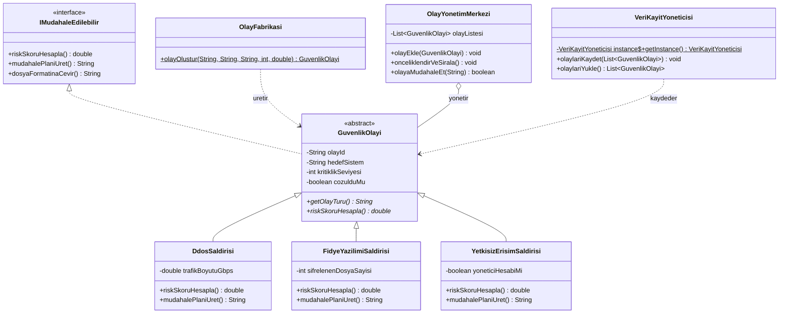

# Siber Güvenlik Olay Yönetimi ve Triyaj Sistemi

Bu proje, Nesneye Yönelik Programlama (NYP) dersi kapsamında geliştirilmiş konsol tabanlı bir Siber Güvenlik Olay Yönetim uygulamasıdır.

## Uygulanan OOP İlkeleri
- **Kapsülleme (Encapsulation):** `GuvenlikOlayi` sınıfındaki tüm alanlar `private` tanımlanmış, sınır kontrolleri (`1-10` kritiklik seviyesi) `getter/setter` metotları ile sağlanmıştır.
- **Kalıtım (Inheritance):** `DdosSaldirisi`, `FidyeYazilimiSaldirisi` ve `YetkisizErisimSaldirisi` sınıfları `GuvenlikOlayi` üst sınıfından türetilmiştir.
- **Soyutlama (Abstraction):** `IMudahaleEdilebilir` arayüzü ve `GuvenlikOlayi` soyut sınıfı kullanılmıştır.
- **Çok Biçimlilik (Polymorphism):** `riskSkoruHesapla()` ve `mudahalePlaniUret()` metotları her saldırı türünde kendine özgü formüllerle `@Override` edilmiştir.

## Uygulanan SOLID Prensipleri (5/5)
1. **Single Responsibility (SRP):** Dosya işlemleri `VeriKayitYoneticisi`, nesne üretimi `OlayFabrikasi`, sıralama ve yönetim `OlayYonetimMerkezi` tarafından ayrı ayrı yürütülür.
2. **Open/Closed Principle (OCP):** Sisteme yeni bir saldırı türü eklendiğinde `OlayYonetimMerkezi` kodları değiştirilmeden sadece `GuvenlikOlayi` sınıfından yeni bir alt sınıf türetilir.
3. **Liskov Substitution Principle (LSP):** Tüm alt saldırı sınıfları, üst sınıf olan `GuvenlikOlayi` referansı yerine sorunsuzca kullanılabilir.
4. **Interface Segregation Principle (ISP):** `IMudahaleEdilebilir` arayüzü yalnızca olay müdahale ve skorlama sözleşmelerini barındırır.
5. **Dependency Inversion Principle (DIP):** `OlayYonetimMerkezi`, somut alt sınıflara değil soyut `GuvenlikOlayi` sınıfına bağımlıdır.

## Uygulanan Tasarım Kalıpları (Design Patterns)
1. **Factory Method Pattern (`OlayFabrikasi`):** Kullanıcı girdisine veya dosya verisine göre uygun alt sınıf nesnesini üretir.
2. **Singleton Pattern (`VeriKayitYoneticisi`):** Dosya okuma/yazma (`guvenlik_olaylari.txt`) işlemlerinin tek bir örnek üzerinden güvenli yapılmasını sağlar.

## Algoritma
- **Ağırlıklı Risk Triyaj ve Öncelik Sıralama Algoritması:** Aktif güvenlik olaylarını çözülmüş olanlardan ayırarak her saldırı türünün polimorfik risk skoruna göre büyükten küçüğe sıralar (Selection Sort tabanlı).

## UML Sınıf Diyagramı

